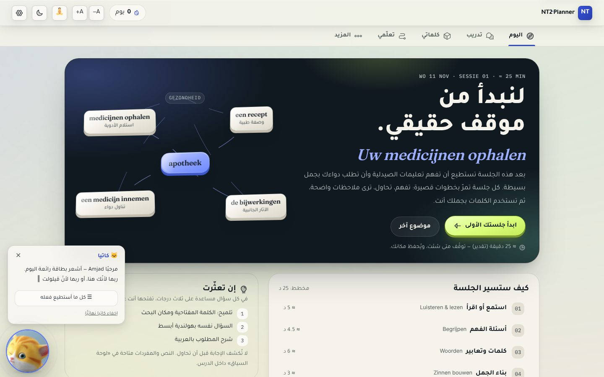
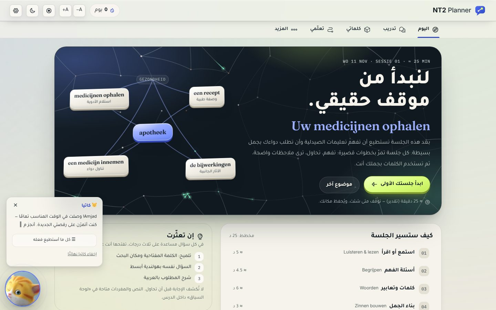
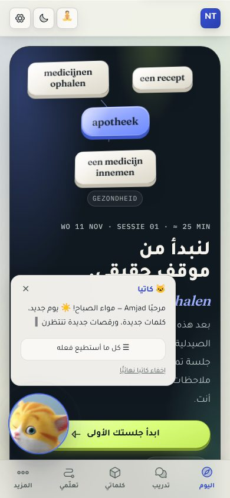
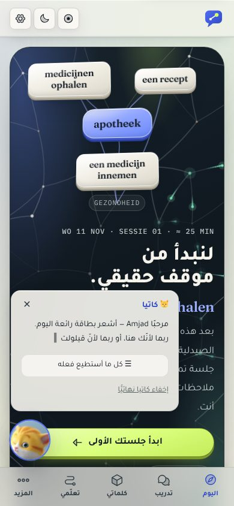
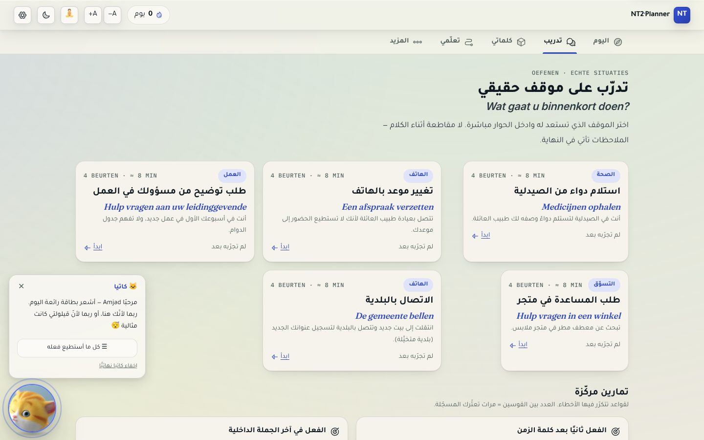
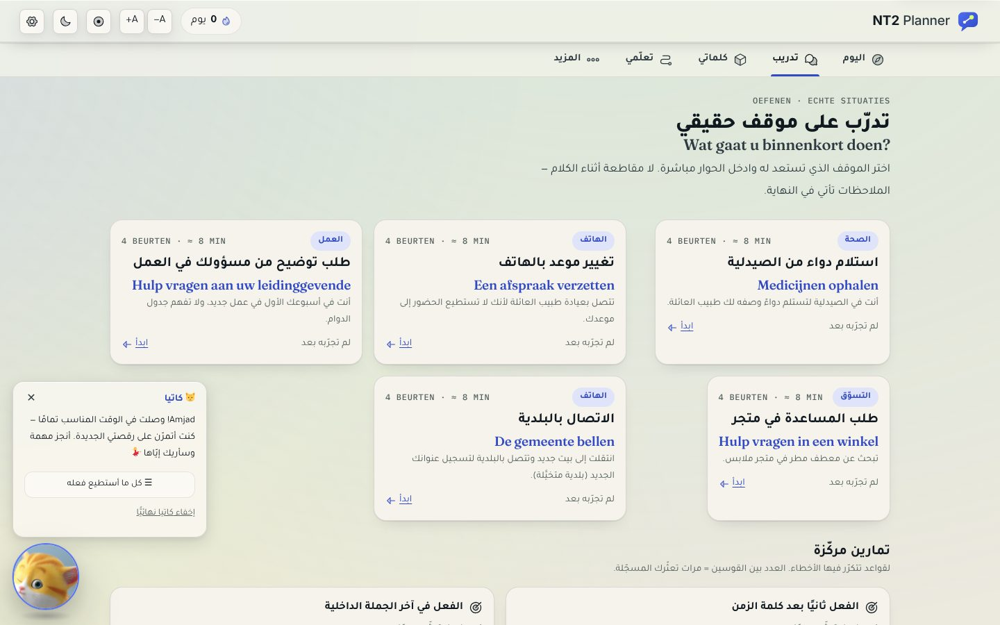
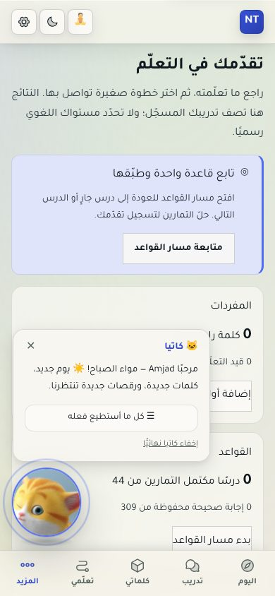
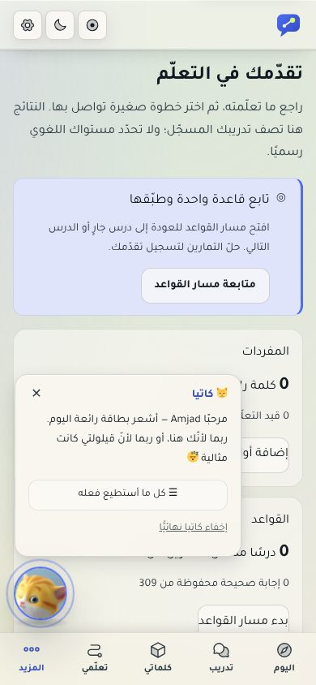
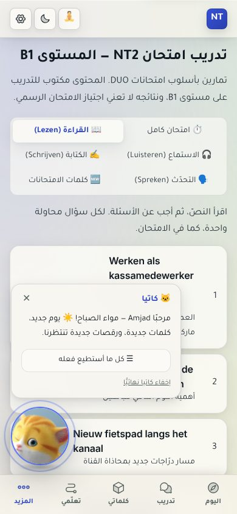
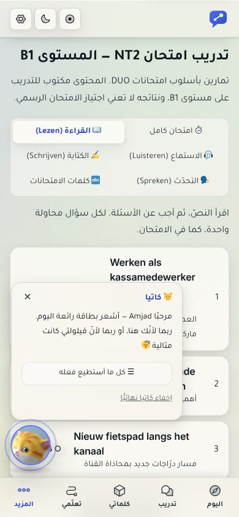

# Interface refinement and defect repair — report

Scope: the whole app (5 daily workspaces + 11 tools under «المزيد»), light and dark.
Nothing here changes what is stored: no store field, no migration, no `_v` bump.

## 1. Visual direction

**"Night plane, paper planes, one light."** The identity that was already strongest —
the obsidian hero, satin word objects, cobalt/mint/lime accents — is kept and made
consistent instead of replaced.

- **One light, top-left.** The hero plane, every word object, the speaking orb and
  their shadows are now lit from the same corner: a rim line on top, a face that
  rolls off toward its lower edge, a two-tone wall, a tight contact shadow plus a
  soft cast thrown down-right.
- **Glass is a material with four grades**, by how far a surface floats:
  `control` → `panel` → `bar` → `float` (`--glass-fx-*` in `src/styles/tokens.css`).
  Bars went from .84/.86 to .72 alpha so content really shows through; inactive
  navigation labels moved from `--muted` to `--text2` so they still clear 4.5:1
  over the darkest thing that scrolls beneath them.
- **Upright type only.** Tajawal (Arabic), Inter (Dutch body), Fraunces (Dutch
  display), IBM Plex Mono (metadata). Emphasis is weight and colour, never a slant.
- **Numbers are tabular** app-wide, and percentages keep digit-then-sign order
  inside right-to-left sentences.
- **Emoji are artwork from one set** (Twemoji), drawn by a local font; controls
  use the icon set instead of emoji.
- **One depth ladder** (`--z-nav` … `--z-toast`) replaces scattered numbers.

## 2. Defect log

"Before" = commit `effc653`. Every row was reproduced before it was fixed.

| # | Screen | Reproduce | Expected / actual | Root cause | Fix | Verified by |
|---|--------|-----------|-------------------|------------|-----|-------------|
| 1 | Today, phone | Open the app at 390px while Katja's greeting is showing; tap «ابدأ جلستك الأولى» | Tap starts the session / tap did nothing across ~82% of the button | The fixed wrapper around Katja is as wide as her bubble; its empty strip beside the launcher swallowed pointer input | Wrapper `pointer-events: none`; bubble, panel and launcher opt back in | `elementFromPoint` probe across the button: 0 of 11 points hit the button before, 9 of 11 after (the other 2 are the launcher itself); `interface-refinement.test.ts` |
| 2 | Every screen, phone | Open any screen on first visit | Content readable / greeting bubble (280×170) sat on the heading and the primary action until dismissed by hand; 96px launcher covered the button edge | Bubble never closed on its own; launcher sized for desktop | Bubble closes 9 s after the line finishes typing (held while hovered or focused); launcher is 64px under 768px; close button is a full touch target | Screenshots at 390px; timed in the production build: typed at ~3 s, gone by 12 s; stays while the pointer rests on it |
| 3 | Today hero | Look at the links between word objects | A connected picture / short strokes that stopped short of anything | Links were independent SVG paths drawn to label positions; a word's context link used a hard-coded index (`1` = "telephone") into a de-duplicated list, so it pointed at whichever label was second, or at nothing | New network (`features/observatory/neural.ts` + `components/obs/NeuralField.tsx`); contexts are looked up by label | `neural-network.test.ts` (46 assertions); screenshots |
| 4 | Dutch display lines (hero, lesson, practice cards) | Read any Dutch title | Upright Fraunces / slanted | `font-style: italic` on a family loaded upright only — the browser was synthesising an oblique | Italic removed everywhere (10 call sites); `font-synthesis-style: none` at the root | `interface-refinement.test.ts`; screenshots |
| 5 | Workspace headers | Compare the Dutch subtitle with the hero's | Same display face / headers rendered in Inter | `:lang(nl)` in `globals.css` also matches descendants of a Dutch element, resetting an inner `` to the body face | Children of `.o-nl-display` inherit the line's type | Screenshots |
| 6 | Stats («التحليلات») | Open the page | Buttons look like buttons / three raw boxes with no padding or radius | `.btn-glass` defined only the material; a bare use had no shape. One button used `btn-secondary`, a class with no rule at all | Shape defaults on `:where(.btn-glass)` (zero specificity, call sites still win); the stray button uses `.btn` | Screenshots; `interface-refinement.test.ts` |
| 7 | Vocabulary, 320px | Open «المفردات» at 320px | No sideways scroll / page scrolled 38px | Search field in a flex row had no `min-width: 0`, so it could not shrink | `min-w-0` on the field, button does not shrink | Overflow scan at 320/390/768/1024/1440 on 12 screens: none left |
| 8 | Any Arabic sentence with a percentage | Compare «90% من وقت دراستي» (Platform) with a stat tile | Same order everywhere / "%90" in sentences, "90%" in tiles | `%` is a bidi neutral; after an Arabic letter it takes the paragraph direction | `pct()` in `src/lib/utils.ts` wraps the token in a left-to-right isolate; applied at 15 call sites | `interface-refinement.test.ts`; `journey-hero.test.tsx` |
| 9 | Glass surfaces, browsers without `backdrop-filter` | — (read from the stylesheet) | Near-solid fallback / no fallback at all | The fallback targeted a bare `:root`, which the skin selector outranks, and still carried the retired orange palette | Fallback rewritten against both skin selectors; `prefers-reduced-transparency` added | `interface-refinement.test.ts`. **Not rendered in such a browser** |
| 10 | Top bar | Toggle focus mode | State is perceivable / a 🧘 emoji dimmed to 70% opacity, no pressed state | An emoji cannot take `color`, so "off" was faked with opacity; no `aria-pressed` | Icon in the control colour + `aria-pressed` | Screenshots; DOM check |
| 11 | Installed app | Install the PWA | Icon and splash match the app / orange `theme_color` from the retired palette; maskable icon was the same file as the plain one, so the launcher cropped it; `favicon.svg` was never referenced | Manifest not updated when the palette changed | New icons, dedicated maskable icon, manifest colours, favicon linked | `interface-refinement.test.ts`. **Not tested on a real device** |
| 12 | Emoji, all screens | Compare ⚠ with ⚠️, ⏱ with ⏱️ | One look / thin text glyph in some places, colour emoji in others, different per device | Missing variation selectors; no emoji font shipped | Sequences normalised; local emoji face | `emoji-registry.test.ts` |
| 13 | Toast while a sheet is open | Trigger a toast with a bottom sheet open | Toast visible / under the dimmed backdrop | Toast `z-index` 950, sheet backdrop 960 | `--z-toast: 980` on the shared ladder | Read from the stylesheet; **not exercised interactively** |
| 14 | Sign-in dialog | Open the first-run sign-in dialog | A Google mark / a boxed or empty glyph on some devices | The "G" was a lone regional-indicator letter — half of a flag sequence, not a character meant to stand alone | Plain Latin "G"; a test rejects any unpaired regional indicator | `emoji-registry.test.ts` |
| 15 | Test suite | `npm test` on `effc653` | Green / 6 tests failing | The observatory layer was merged with 96 off-scale spacings, 5 raw type values, 32 unused tokens, a second shadow ladder and its own page container | Spacings moved to the 4px scale (≤2px change each), tokens removed, workspaces use the shared `.page` shell | `npm test`: 702 → 772 tests, all passing |

Emoji meaning corrections (part of 12): 🇸🇦 for "Arabic" removed (a language is not
one country); ⬜ "fill the gap" → 🧩; 🆕 for the exam-words tab → 🔤; 🎴 → 🗂️;
🎤 → 🗣️ (same concept as the speaking tab); 🕯️ "no streak" → 🌱; 🌊 "peak" → 📈;
✅ / ⏱️ / 📊 as grammar-lesson icons → ☑️ / ⌛ / 🪜 (they already meant "correct",
"study time", "analytics"); 🔎 merged into 🔍; doubled title emoji removed.
▶ ⏹ ↗ ⬇ 🗑 used as controls are now icons from the app's icon set.

## 3. Neural network

- `buildNetwork` lays junctions over the whole hero (and a ring just outside it, so
  fibres run off the frame), joins them to each other and to the word objects, and
  guarantees a single connected graph with no crossing between ambient fibres.
- Word objects are measured from the DOM (`data-neural-id` / `data-neural-to`), so
  fibres end on them and follow them when the layout changes.
- `planWave` fires a signal from the topic: each node passes it on at the instant it
  is first reached; every fibre carries exactly one signal. Fibre and signal use the
  same curve function (`pointOnEdge`).
- One canvas, no blur filters, 2× density cap. The loop stops when the hero is
  off-screen or the tab is hidden. With reduced motion a single still frame is drawn.

The app has no separate splash screen; the Today hero is the first thing shown, so
that is where the network lives. `index.html` now paints the logo before the
JavaScript arrives; React replaces it on first render, so it adds no delay.

## 4. Logo

Concept — *the connected conversation*: a speech bubble holding two linked points.
The small point is where the learner starts, the large one where they are going.

| File | Use |
|------|-----|
| `public/brand/logo-mark.svg` | Editable vector master (512 grid, no text, no effects) |
| `public/brand/logo-mark-light.svg`, `logo-mark-dark.svg` | For light / dark backgrounds |
| `public/brand/logo-mark-mono.svg` | One colour, points cut out |
| `public/brand/logo-lockup-light.svg`, `logo-lockup-dark.svg` | Mark + wordmark (live text) |
| `public/brand/app-icon.svg`, `app-icon-maskable.svg` | App icon sources |
| `public/brand/png/*` | Transparent exports (256, 1024, dark, mono) |
| `public/icons/icon-192.png`, `icon-512.png`, `icon-maskable-512.png`, `apple-touch-icon.png`, `public/favicon.svg` | What the app and manifest reference |
| `src/components/brand/Logo.tsx` | Inline component (top bar), follows the theme |

## 5. Emoji assets

- Registry: `src/data/emoji/registry.json` — 150 entries: id, Unicode sequence,
  role, Arabic label (accessible name), vector asset path, files that use it.
- Vector assets: `src/assets/emoji/svg/` (one SVG per entry).
- Font: `src/assets/emoji/nt2-emoji.woff2` (28 KB, COLR vector, only those 150).
- Licence: `src/assets/emoji/LICENSE.md` (Twemoji graphics CC-BY 4.0, font OFL 1.1).
- Rebuild: `scripts/build-emoji.py`. Component for a stand-alone emoji:
  `src/components/ui/Emoji.tsx`.

## 6. Checks and their results

| Check | Result |
|-------|--------|
| `npm run typecheck` | pass |
| `npm run lint` | pass |
| `npm test` | 772 passed, 0 failed (was 696 passed, 6 failed) |
| `npm run check:digits`, `check:exams`, `check:docs` | pass |
| `npm run build` | pass |
| Horizontal overflow, 12 screens × 320/390/768/1024/1440 | none after fix 7 |
| Console errors and failed requests | none on 16 screens (light, 390 and 1440), 12 screens (dark, 320/768/1024), and the production build's first-run flow |
| Saved state, production build | guest → onboarding → start a session by touch → reload: name and onboarding kept, session offered for resume |
| Hero animation, headless Chromium (software rendering) | median frame 33 ms at 1440px and at 390px with 4× CPU throttle; still frame with reduced motion |

Everything visual was checked in **headless Chromium under emulation**. Not tested:
real phones or tablets, Safari, Firefox, screen readers, 200% zoom, an installed PWA.
The frame times above come from a software renderer and say nothing reliable about
a real device.

## 7. Screenshots

Matching screen and viewport, before → after:

| | Before | After |
|---|---|---|
| Today, 1440 |  |  |
| Today, 390 |  |  |
| Practice, 1440 |  |  |
| Stats, 390 |  |  |
| Exam, 390 |  |  |

Also: [dark theme](screens/after-1440-today-dark.jpg) ·
[reduced motion](screens/after-1440-today-reduced-motion.jpg) ·
[logo sheet](screens/logo-sheet.jpg)
